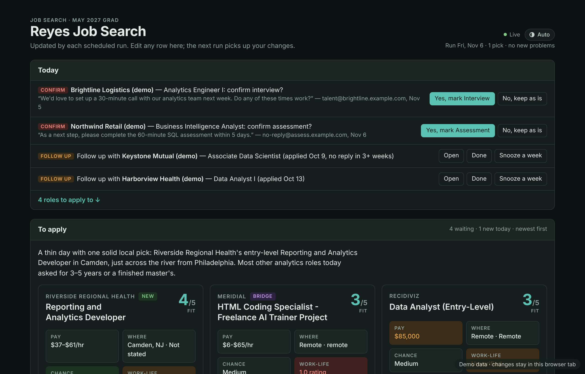
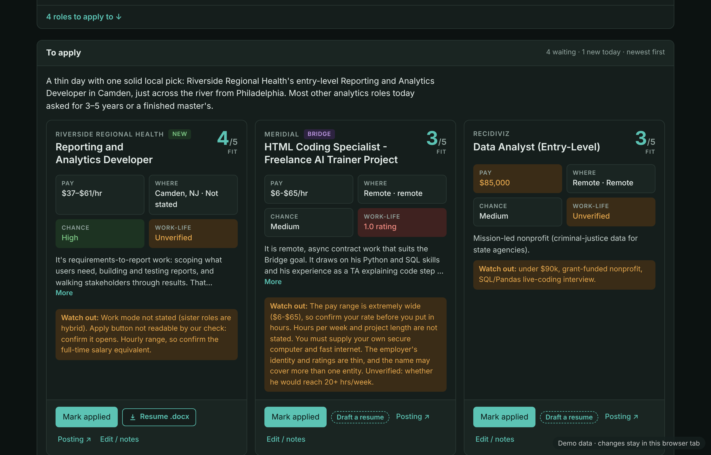
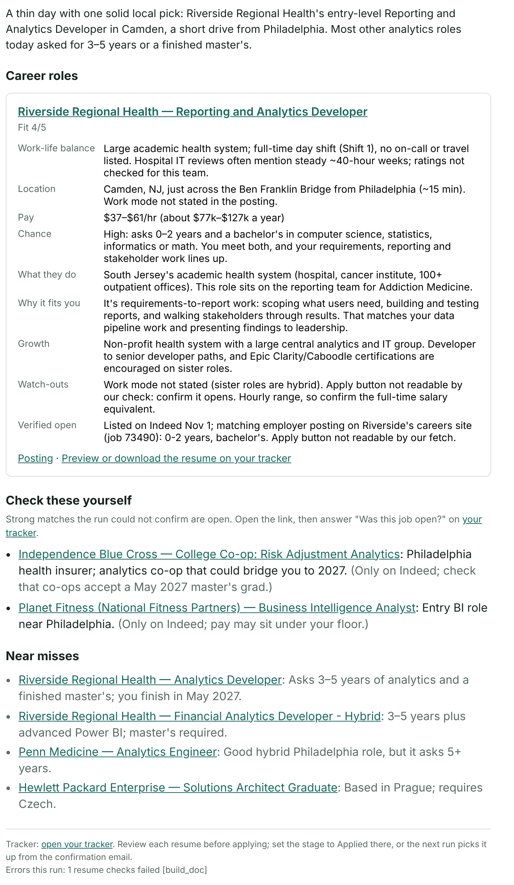
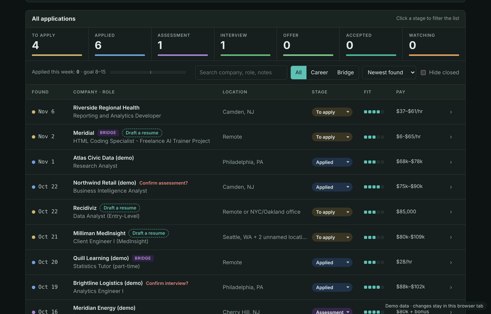

# Shortlist

**Shortlist finds the few jobs actually worth applying to, explains why each one fits, and keeps track of everything after you apply.**

> **Status:** working single-user pipeline (ran daily Oct 23 – Nov 2, 2026), now being rebuilt as a multi-user web app: FastAPI, Supabase/Postgres, Next.js + TypeScript, Google sign-in. See the [roadmap](#roadmap).


> **Try it:** open [`docs/demo/tracker-demo.html`](docs/demo/tracker-demo.html) in a browser (download it and open it locally). It runs fully offline on a fictional candidate, Daniel Reyes, with real job listings from a run on Nov 6, 2026 (one employer renamed). Every button works; changes stay in your browser tab.

## Why

Job boards are noisy. Many "entry-level" listings ask for 3–5 years of experience, many are expired or copied across aggregators, and the pay, location and work-life details you care about are buried or missing. Shortlist reads the listings for you, drops the ones that clearly don't fit, checks that the rest are really open, and sends a short, explained list each weekday morning.

## What it does

- **Searches** a rotating slice of job-board and web queries each day (`scripts/rotation.py`, queries in config).
- **Filters at zero model cost:** normalize, dedupe, hard filters (seniority, years required, location, work mode, pay floor, employers to avoid, role families) and a pre-score (`scripts/prefilter.py`). Rules live in config, not code.
- **Parses the messy parts:** pay (ranges, "k" notation, hourly vs. yearly, 401(k) noise) and start dates.
- **Verifies listings are open** by matching aggregator copies to the employer's own posting; ones it can't confirm become "check these yourself."
- **Judges fit with Claude** against weighted goals (work-life balance, location, pay, chance, growth), with a plain-English "why it fits" and "watch out" for each pick.
- **Tailors a resume** for each pick. `scripts/validate_resume.py` rejects any resume that adds facts not in the profile, and `scripts/build_doc.py` checks it fits on one page.
- **Sends a morning digest** and updates a **tracker** (`site/tracker.html`) with the pipeline, follow-up reminders, and status changes found in the inbox, which you confirm before they're applied.

## Roadmap

Shortlist is being rebuilt from a single-user pipeline into a multi-user web app:

- FastAPI API and worker with a Postgres-backed job queue; Docker Compose for local dev
- Supabase (Postgres, Google sign-in, storage) and a Next.js + TypeScript front end
- Structured listing extraction with Claude Haiku, replacing hand-written parsers
- Company ATS boards as the primary source, with auto-discovery; Adzuna for breadth, labeled "unconfirmed" until matched
- Per-user AI budget guard; per-user secrets protected with AES-256-GCM envelope encryption

## Demo

| Today: inbox updates to confirm, follow-ups | Today's picks |
|---|---|
|  |  |
| **Morning digest email** | **Application pipeline** |
|  |  |

One run (Nov 6, 2026), step by step in [`docs/demo/run/`](docs/demo/run/): **49 listings found → 9 shortlisted and checked → 1 pick**, plus near misses with the reason each one fell short and 2 "check these yourself."

## How it works

```
rotation (today's queries) ──► search ──► prefilter (config rules, pay + start-date parsing, pre-score)
    ──► verify open ──► judge & score (Claude) ──► tailor resume ──► validate + build .docx
    ──► digest email + tracker ◄── inbox updates (confirmed by you)
```

The pipeline ran daily as a scheduled agent session (Oct 23 – Nov 2, 2026, plus the Nov 6 demo run): scripts do every step that needs no judgment, Claude Haiku helpers do lookups, and one Claude Opus helper does the judging (see `docs/legacy-run-procedure.md`, documentation only). Prompts live in `prompts/`.

All personal data (profile, preferences, never-apply lists, private leak patterns) lives in a separate private config repo, read only through `scripts/config.py`. This repo holds the engine and a fully fictional example config (`config.example/`).

## Engineering notes

- **Config-driven:** goals, weights, places, role families and exclusions are YAML.
- **No personal data in the repo:** `scripts/leak_check.py` runs as a pre-commit hook and in CI, checking for real emails, phone numbers and private patterns supplied as a CI secret (matches are never printed). gitleaks scans every commit for secrets.
- **Tested:** config loading, prefilter rules (case table in `tests/prefilter_cases.json`), personal rules, pay parsing, leak checking and telemetry, all run in CI on every push.
- **Telemetry and budget guard:** `scripts/telemetry.py` records tokens, cost, time and outcome of every model call, rolled up per step and per run, and stops model calls once a run's budget is spent. Built and tested for the API version; the agent-session pipeline doesn't route its calls through it yet.

## Running the tests

```sh
pip install "anthropic<1" pyyaml
npm ci
for t in tests/test_*.py; do CONFIG_DIR=config.example python3 "$t"; done
python3 scripts/leak_check.py --all
```

`tests/test_telemetry_sql.py` needs Postgres 16 binaries and skips without them.

Secret scan with gitleaks:

```sh
bash scripts/install_gitleaks.sh
.tools/gitleaks dir --config .gitleaks.toml --redact --no-banner .
```

## History

Developed in a private repo that held personal data. Personal config was moved out and this copy was published without history.

## License

MIT, see `LICENSE`.
